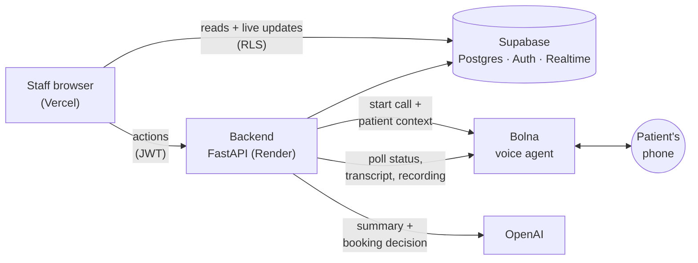

# CareVoice

**AI voice operations for hospitals in India.** CareVoice phones patients from the hospital's own records
(appointment reminders, missed-appointment follow-ups and post-visit check-ins) in **Telugu, Hindi or
English**, offers **real doctor availability**, books or reschedules the appointment the patient agrees to,
and returns every call to staff with an **AI summary, transcript and recording**.

Staff run everything from a navy-and-white **Call Center** dashboard that updates live.

---

## Contents
1. [What it does](#1-what-it-does)
2. [How it works](#2-how-it-works)
3. [Tech stack](#3-tech-stack)
4. [Project structure](#4-project-structure)
5. [Run it locally](#5-run-it-locally)
6. [Using the app](#6-using-the-app)
7. [Scripts](#7-scripts)
8. [Deployment](#8-deployment)
9. [How we implemented it](#9-how-we-implemented-it)
10. [Security](#10-security)
11. [Troubleshooting](#11-troubleshooting)
12. [Status and roadmap](#12-status-and-roadmap)
13. [Documentation index](#13-documentation-index)

---

## 1. What it does

| Feature | Details |
|---|---|
| **Follow-up queue from hospital records** | Lists who to call today and why: *appointment tomorrow* → reminder, *missed appointment* → rebook, *recent visit* → post-visit follow-up. Patients who opted out or set DND are excluded. |
| **One-click real phone calls** | Each queue row has a **Call** button. The call goes out through **Bolna** to the patient's phone with the patient's name, appointment and purpose. |
| **Live doctor availability on the call** | The agent is given the real open slots from the database (e.g. "2 doctors available: Dr. Ramesh Reddy, tomorrow 9 AM or 9:15 AM…") in the patient's language, and may offer only those. |
| **Booking from the conversation** | After the call, the slot the patient clearly agreed to is booked automatically. A reminder call that ends with a new time is a **reschedule**, and "yes, I'll come" marks the appointment **confirmed**. |
| **Call results** | Every call gets an AI summary, the full transcript (patient / agent), the recording, a timeline, the slots offered and a green "Appointment booked" card. |
| **Live dashboard** | Call status (dialing → ringing → in conversation → completed) updates in real time through Supabase Realtime. |
| **Hospital data pages** | **Patients** (search, language filter, profile drawer with caregiver, appointments, call history), **Appointments** (calendar day view with doctors as columns, list view, *Mark arrived*), **Doctors** (Telugu/Devanagari names, today's availability bar), **Agents**. |
| **Browser voice test (local)** | Talk to the AI agent in your browser. It verifies you, searches doctors and books through the same rules engine (Pipecat + Sarvam + OpenAI). |
| **Multilingual by design** | Times are spoken naturally in each language ("రేపు ఉదయం 9 గంటలకు", "कल सुबह 9 बजे", "tomorrow at 9 AM"). The agent mirrors Telugu/Hindi/English code-mixing. |
| **Secure multi-hospital data** | Every row belongs to a hospital; staff only see their own hospital's data (Postgres row-level security). |

The demo data is a fictional **Sunrise Multispeciality Hospital** (Hyderabad): 7 departments, 10
doctors, 30 patients, 14 days of appointment slots, recent visits and missed appointments.

---

## 2. How it works



**Life of a call:**
1. Staff click **Call** on a patient in the follow-up queue.
2. The backend loads the patient, their appointment and the **open slots** (each tagged `S1`, `S2`, …),
   records the call, and asks Bolna to dial with those details.
3. The Bolna agent talks to the patient in their language and offers only the listed slots.
4. Every 4 seconds the backend checks the call with Bolna and updates the dashboard (ringing, in
   conversation, completed).
5. When the call ends, the backend saves the transcript and recording. OpenAI reads the transcript and
   reports which slot the patient agreed to, and the backend **books it in code**, re-checking the rules
   (slot still free, no double booking).
6. OpenAI writes a 2–3 line summary. The call card shows the booking, summary, transcript and recording.

Full architecture, database diagram and AI details: **[docs/SYSTEM_DESIGN.md](docs/SYSTEM_DESIGN.md)**.

---

## 3. Tech stack

| Layer | Technology |
|---|---|
| Frontend | React 19, TypeScript, Vite, Tailwind CSS v4, shadcn/ui (Radix), TanStack Query, React Router, framer-motion, Zod, supabase-js, Pipecat client |
| Backend | Python 3.11, FastAPI, SQLAlchemy 2 (async) + asyncpg, Pydantic v2, PyJWT, APScheduler, httpx |
| Database & auth | Supabase: Postgres (row-level security), Auth, Realtime, Storage; schema managed with the Supabase CLI |
| Phone calls | Bolna (telephony + speech + LLM in one hosted voice agent) |
| AI | OpenAI `gpt-4.1-mini` (summaries, post-call decisions, browser agent), Sarvam AI `saaras:v3` speech-to-text and `bulbul:v3` text-to-speech |
| Browser voice | Pipecat 1.11, SmallWebRTC, Silero VAD |
| Hosting | Vercel (frontend), Render (backend + background jobs), Supabase (data) |
| Tooling | npm workspaces-style root scripts with `concurrently`, pytest, oxlint, TypeScript strict |

---

## 4. Project structure

```
backend/                FastAPI API + background jobs
  app/
    api/                routes: health, auth, appointments, calls, internal (voice service)
    services/           tools, outbound calls (Bolna), availability, post-call booking, summaries, slots, audit
    policy/             Policy Engine: may this agent run this tool right now?
    providers/          Bolna, OpenAI, Sarvam, telephony interfaces
    jobs/               scheduler jobs + Postgres job queue
    models/ db/ core/   ORM models, database session, settings, time/phone helpers
    seed.py             demo hospital seed (idempotent)
  worker.py             runs the background jobs locally
  tests/                pytest suite
frontend/               React dashboard
  src/pages/            Call Center, Call Records, Patients, Appointments, Doctors, Agents, Login
  src/components/       call detail drawer, calendar, patient drawer, test-call panel, app shell, design system
  src/lib/              Supabase client, Zod schemas, API client, env, time helpers
voice/                  local browser voice agent (Pipecat)
supabase/migrations/    database schema (source of truth)
docs/                   design, architecture, deployment, Bolna setup, progress
scripts/                cross-platform setup and runner scripts
render.yaml             Render blueprint (backend)
```

---

## 5. Run it locally

### 5.1 Prerequisites
| Tool | Version | Get it |
|---|---|---|
| Node.js | 20+ | https://nodejs.org |
| Python | **3.11** | https://www.python.org/downloads/ (Windows: tick *Add to PATH*) |
| Accounts | — | [Supabase](https://supabase.com) (free), [OpenAI](https://platform.openai.com), [Bolna](https://platform.bolna.ai) for phone calls, [Sarvam AI](https://dashboard.sarvam.ai) for the browser voice test |

### 5.2 Install
```bash
npm install
```
```bash
npm run setup
```
`npm run setup` creates Python virtual environments in `backend/.venv` and `voice/.venv`, installs all
dependencies, and creates `backend/.env`, `voice/.env` and `frontend/.env` from the `.env.example`
templates. It never overwrites an existing `.env`.

### 5.3 Fill in the `.env` files

**Supabase** (open your project at https://supabase.com/dashboard):

| Variable | Where to find it | Goes in |
|---|---|---|
| `SUPABASE_URL` / `VITE_SUPABASE_URL` | **Project Settings → Data API → Project URL** (`https://<project-ref>.supabase.co`) | backend, frontend |
| `VITE_SUPABASE_ANON_KEY` | **Project Settings → API Keys** → **anon / publishable** key. Public by design. | frontend only |
| `SUPABASE_SERVICE_ROLE_KEY` | **Project Settings → API Keys** → **service_role / secret** key. ⚠️ Bypasses all security: backend only. | backend |
| `SUPABASE_JWT_SECRET` | **Project Settings → JWT Keys** → *Legacy JWT secret* (only used for older projects) | backend |
| `DATABASE_URL` | **Connect** (top of dashboard) → **Session pooler** string, with your database password filled in. URL-encode special characters (`@` → `%40`). | backend |

**Everything else:**

| Variable | Where | Goes in |
|---|---|---|
| `OPENAI_API_KEY` | https://platform.openai.com/api-keys | backend, voice |
| `BOLNA_API_KEY`, `BOLNA_AGENT_ID` | Bolna → **Developers → API Keys**; agent ID from the agent page. Setup: [docs/BOLNA_AGENT.md](docs/BOLNA_AGENT.md) | backend |
| `SARVAM_API_KEY` | https://dashboard.sarvam.ai → API keys (browser voice test) | backend, voice |
| `INTERNAL_API_KEY` | Make one up: any long random string. **Same value** in `backend/.env` and `voice/.env`. | backend, voice |
| `SEED_TEST_PHONE` | Your own mobile, e.g. `+919876543210`. Becomes patient #1 so you can call yourself. | backend |
| `SEED_TEST_NAME`, `SEED_TEST_DOB` | Optional name and birth date of that test patient (used for caller verification) | backend |
| `DEMO_ADMIN_EMAIL`, `DEMO_ADMIN_PASSWORD` | The dashboard login the seed creates | backend |
| `VITE_API_URL`, `VITE_VOICE_URL` | `http://localhost:8000` and `http://localhost:8001` locally | frontend |

### 5.4 Create the database
```bash
npx supabase login
```
```bash
npm run db:link -- --project-ref <your-project-ref>
```
```bash
npm run db:push
```
```bash
npm run db:seed
```
- `db:push` creates all 23 tables, row-level security, realtime and the private `recordings` bucket.
- `db:seed` creates the demo hospital, doctors, slots, patients, appointments, the six agents and your
  admin login. It is safe to run again; it only adds what's missing.
- **Demo data is relative to today.** Re-run `npm run db:seed` before a demo, after a break, to roll it
  forward: fresh upcoming appointments, recent visits and missed appointments for the queue, and an
  appointment tomorrow for your test patient. Open slots are topped up automatically every hour by the
  background jobs.

Demo patients use `+91 555…` numbers, which no Indian mobile uses, so automatic calls can never reach a
real person. Only patient #1 (your `SEED_TEST_PHONE`) is dialable.

### 5.5 Set up the Bolna phone agent
Follow **[docs/BOLNA_AGENT.md](docs/BOLNA_AGENT.md)**. You create the agent, paste the prompt (it uses the
variables CareVoice fills in on each call), and copy the API key and agent ID into `backend/.env`.

### 5.6 Start everything
```bash
npm run dev
```
| Label | What | URL |
|---|---|---|
| `backend` | FastAPI API | http://localhost:8000/docs |
| `voice` | Browser voice agent | http://localhost:8001/health |
| `worker` | Background jobs (call sync, summaries, bookings, cleanup) | — |
| `web` | Dashboard | **http://localhost:5173** |

Press **Ctrl C** to stop. Run one piece at a time with `npm run dev:backend`, `dev:voice`, `dev:worker`
or `dev:frontend`.

The Python services don't auto-reload. Restart `npm run dev` after changing backend code or any `.env`
file.

---

## 6. Using the app

1. Open http://localhost:5173 and sign in with `DEMO_ADMIN_EMAIL` / `DEMO_ADMIN_PASSWORD`. The status pill
   in the top bar should say **All systems normal**; click it for details.
2. **Call Center** shows the follow-up queue. Your test patient (**Priya Reddy** by default) has an
   appointment tomorrow, so it appears as an *Appointment reminder*. Click **Call**.
3. Answer your phone. Ask to change the appointment, pick one of the times offered, and say yes.
4. Within a few seconds of hanging up, open the call under **Recent calls**. You'll see the booking card,
   the offered slots, the summary, the recording and the transcript. The new time is on the
   **Appointments** calendar.
5. **Test Call → Phone call** dials any number you type (Bolna trial accounts: verified numbers only).
   Locally, **Test Call → Browser** lets you talk to the agent through your microphone.

---

## 7. Scripts

| Command | Does |
|---|---|
| `npm run setup` | Create Python venvs, install all dependencies, create `.env` files |
| `npm run dev` | Start backend, voice service, worker and dashboard together |
| `npm run dev:backend` / `dev:voice` / `dev:worker` / `dev:frontend` | Start one service |
| `npm test` | Backend test suite (pytest) |
| `npm run build` | Production build of the dashboard |
| `npm run db:link -- --project-ref <ref>` | Link the Supabase CLI to your project |
| `npm run db:push` | Apply migrations in `supabase/migrations` |
| `npm run db:seed` | Seed the demo hospital (idempotent) |

---

## 8. Deployment

| Part | Host |
|---|---|
| Dashboard (`frontend/`) | **Vercel**: root directory `frontend`; set `VITE_SUPABASE_URL`, `VITE_SUPABASE_ANON_KEY`, `VITE_API_URL` (type *Config*) |
| Backend (`backend/`) | **Render**: *New → Blueprint* reads `render.yaml`; secrets are entered in Render; background jobs run inside the API (`RUN_SCHEDULER=true`) |
| Database | **Supabase** (already hosted) |

The browser voice test stays local, because WebRTC over the internet needs a TURN server. Step-by-step
guide: **[docs/DEPLOY.md](docs/DEPLOY.md)**.

---

## 9. How we implemented it

The project was built in phases (tracked in [docs/PROGRESS.md](docs/PROGRESS.md)). These are the key
decisions, and why.

### Data and multi-tenancy
- **Supabase Postgres is the single source of truth.** The schema is written as SQL migrations, and the
  backend's SQLAlchemy models mirror it.
- **Every table has a `tenant_id`** (the hospital) and **row-level security**. A SQL function
  `current_tenant_id()` looks up the signed-in staff member's hospital, and every read policy uses it.
  This makes the product multi-hospital from day one.
- **Reads go direct, writes go through the API.** The dashboard reads with supabase-js (anon key + the
  user's session, filtered by RLS) and gets live updates from Supabase Realtime. Anything that changes data
  (placing a call, marking arrival, booking) goes through FastAPI, which verifies the user's token and
  role. The browser has no write permissions on any table.
- **No Redis.** Short-lived state lives in Postgres with expiry columns: 3-minute slot holds and 30-minute
  caller verification. Background work is a Postgres job queue using `SELECT … FOR UPDATE SKIP LOCKED`.
- **Times are stored in UTC and shown in IST.** Appointment slots are generated from each doctor's weekly
  schedule (with lunch breaks) for a rolling 14 days, topped up hourly by a background job.

### Phone calls (Bolna)
- **Context in.** For each call the backend sends Bolna variables: patient name, hospital, appointment
  details spoken in the patient's language, the call's purpose, and an **availability snapshot** of real
  open slots, each with a short code (`S1…Sn`).
- **No webhooks needed.** The scheduler polls Bolna every 4 seconds, so the backend doesn't need a public
  URL. Status changes are written to the database, and Realtime pushes them to the dashboard.
- **Decisions out, applied in code.** After the call, OpenAI (JSON mode) reads the transcript and reports
  the agreed slot code. Its answer is validated by a strict Pydantic model; only a code that was actually
  offered on that call is accepted. The booking itself is plain code that re-checks the rules. If the
  slot was taken meanwhile, staff get an escalation instead.

### Browser voice agent (Pipecat)
- **Pipeline:** WebRTC audio → Silero VAD → Sarvam speech-to-text (code-mix mode) → OpenAI with tool
  calling → Sarvam text-to-speech, with interruptions on.
- **The AI never touches the database.** Every tool call (`verify_patient`, `search_doctors`,
  `get_available_slots`, `hold_slot`, `create_appointment`, …) is an HTTP request to the backend. The
  **Policy Engine** checks that the agent may use the tool and that the caller is verified. The tool
  handler then enforces business rules (future slot, own hold, no double booking) in one transaction, and
  every action is logged in `agent_actions` and `audit_logs`.
- **Language follows the patient.** The conversation language is the dominant language of the last three
  patient turns, and the voice switches to match.

### Frontend
- **Data layer:** TanStack Query caches all reads; Realtime events invalidate the right queries, so screens
  update without polling.
- **Validation:** Zod checks the public config (it refuses a secret Supabase key), every API request and
  response, and form input.
- **Design system:** navy and white, defined as CSS variables (light and dark mode), with shared
  components for status pills, language chips, waveforms, KPI cards, tool-call and action cards. Every
  list has loading, empty and error states, and no fake numbers are ever shown.

### Quality
- **Tests:** 47 pytest tests cover the rules engine, slot generation, phone normalisation, JWT
  verification, transcript parsing, AI-output validation and the health endpoint.
- **Checked against the real stack:** RLS isolation, ES256 token verification, Realtime updates and
  booking/rescheduling were verified against the real Supabase project.
- **Static checks:** TypeScript strict mode and oxlint on the frontend.

---

## 10. Security

- **Secrets never leave the server.** `.env` files are git-ignored. Server keys (Supabase service role,
  database URL, OpenAI, Sarvam, Bolna) live only in `backend/.env` locally and in Render's encrypted
  environment. The browser only gets the Supabase URL, the public anon key and the backend URL.
- **Scanned:** the repository and its full git history were checked for keys and personal data (none
  found), and the production frontend bundle was checked for server secrets (none found).
- **Authentication:** Supabase JWTs are verified on the backend (ES256/RS256 via JWKS, HS256 fallback),
  then the staff role is checked per endpoint.
- **Authorisation:** row-level security on all 23 tables. Logged-out requests see nothing, and direct
  writes from the browser are rejected.
- **Audit trail:** every write by staff, agents or the system is recorded with before/after values.

Details: [docs/SYSTEM_DESIGN.md → Security](docs/SYSTEM_DESIGN.md#6-security--secret-management).

---

## 11. Troubleshooting

| Problem | Fix |
|---|---|
| Call Center says **Nobody to call** | The demo data is older than the queue's windows. Run `npm run db:seed` to roll it forward to today. |
| Status pill says **Database down** and nothing loads | Supabase free projects **pause after inactivity**. Open the Supabase dashboard and click **Restore project**. |
| Status pill says **API offline** | The backend isn't running (`npm run dev`), or `VITE_API_URL` is wrong. On Vercel, change it and **redeploy**, because Vite bakes it in at build time. |
| Call fails with *"Trial accounts can only make calls to verified phone numbers"* | Verify that number in Bolna, or upgrade the Bolna account. |
| Phone rings but the call shows **Not answered / busy** | The call was declined or blocked by the phone's spam filter. Answer unknown numbers when testing. |
| The agent doesn't mention the patient or the slots | The Bolna agent's prompt is missing the variables. See [docs/BOLNA_AGENT.md](docs/BOLNA_AGENT.md). |
| Backend changes or `.env` edits have no effect | Restart `npm run dev`; the Python services don't auto-reload. |
| Deployed site can't reach the backend | Check `CORS_ORIGINS` on Render includes the Vercel address. Render's free plan sleeps after 15 minutes, so the first request takes about 50 seconds. |
| Vercel won't save a `VITE_` variable | Create it with type **Config**, not Secret. `VITE_` values are public by design. |
| `virtualenv not found` / `Python 3.11 not found` | Install Python 3.11, then run `npm run setup`. |

---

## 12. Status and roadmap

**Working today:** follow-up queue, real outbound calls (Bolna), live availability on calls, automatic
booking/rescheduling/confirmation from the conversation, summaries, transcripts, recordings, live
dashboard, patients/appointments/doctors pages, browser voice agent (local), deployment to Vercel and
Render.

**Next:**
- inbound calls and a rule-based emergency detector with human transfer;
- an automatic dialer driven by workflow rules;
- Pre-Visit and Caring agents with an approved knowledge base;
- the staff "Ask CareVoice" assistant;
- analytics and cost per call;
- rate limiting;
- copying recordings into private storage.

Phase-by-phase status: [docs/PROGRESS.md](docs/PROGRESS.md).

---

## 13. Documentation index

| Document | Contents |
|---|---|
| [docs/SYSTEM_DESIGN.md](docs/SYSTEM_DESIGN.md) | User roles, system architecture, database schema, AI integration, validation, security |
| [docs/ARCHITECTURE.md](docs/ARCHITECTURE.md) | The engineering rules every change follows |
| [docs/DESIGN.md](docs/DESIGN.md) | Design system: colours, typography, components |
| [docs/DEPLOY.md](docs/DEPLOY.md) | Deploying to Vercel and Render |
| [docs/BOLNA_AGENT.md](docs/BOLNA_AGENT.md) | Bolna phone agent setup and prompt |
| [docs/PROGRESS.md](docs/PROGRESS.md) | Build history and status by phase |
